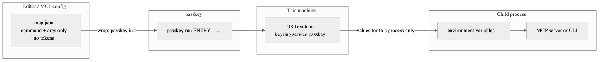

# Passkey

A local OS-keychain injector for MCP and CLI secrets. It stores named
credential sets in your system keychain (`keyring`, service name `passkey`)
and injects them as environment variables at runtime.

This is **not** a team password manager, a shared vault, or a 1Password
replacement. Alpha, 0.x.



No plaintext secrets in config files. No cloud sync. No network. Primary
protection is the OS keychain ACL. Extra sudo/pkexec is **optional and off
by default** (`passkey config require-auth on`) and **never** applies to
`passkey run` (headless MCP). macOS Keychain ACLs are the strong case;
Linux Secret Service and Windows Credential Manager are best-effort by
comparison (Linux also needs a running, unlocked keyring daemon).

## How it works

1. You store named entries (one or more fields per entry) in the OS keychain.
   Values never go in `mcp.json` or in argv. Interactive input uses `getpass`.
2. `passkey init` (opt-in) rewrites existing MCP configs so the editor starts
   `passkey run --quiet ENTRY -- <original command>` instead of a command with
   tokens in `env`. **Install does not scan Claude, Cursor, or other tools.**
   First `passkey` with no args is onboarding (`new`), not a wrap.
3. At start, `passkey run` reads the keychain, injects env vars into **that
   child process only**, and masks resolved secret values (`<concealed by passkey>`)
   across child `stdout` and `stderr`. MCP tools (`passkey_list`, `passkey_fields`,
   `passkey_entry_info`, `passkey_preflight_run`, `passkey_status`, `passkey_doctor`,
   `passkey_wrap_server`, `passkey_validate_references`, `passkey_audit_recent`,
   `passkey_cdp_autofill`) and built-in MCP prompts (`setup-project-secrets`,
   `debug-missing-credential`, `migrate-exposed-mcp-configs`) return names, field
   names, policy/lease readiness, and guided workflows — **never secret values**.
4. `passkey unwrap` restores the original commands. Timestamped `0o600` backups
   are stored in `<data_dir>/backups/` before `init` and `unwrap` (never left in
   workspace directories).

Diagram source: [`docs/architecture.mmd`](docs/architecture.mmd). Disclosure
and threat model: [SECURITY.md](SECURITY.md).

## Features

- Store multiple secrets per entry in the system keychain (macOS Keychain, Windows Credential Manager, Linux Secret Service)
- Inject secrets as environment variables for subprocesses
- **Tool-agnostic** — works with Claude, Gemini, VS Code, Cursor, OpenCode, Windsurf, Cline, Zed, and more
- Interactive fuzzy-search entry picker (arrow keys + type-to-filter)
- **Tab completion** for bash, zsh, and fish
- **Generate** cryptographically secure random secrets (configurable length, guaranteed character diversity)
- **Templates** for popular services and AI CLIs (GitHub, AWS, Slack, OpenAI, Claude, Codex, Gemini, Cursor Agent, Cloudflare Wrangler, Stripe, Vercel, PostgreSQL, MySQL)
- **Real-time `stdout`/`stderr` secret masking** (`<concealed by passkey>`) in `passkey run` and `passkey plugin run`
- **Secret reference URIs & ephemeral `.env` FIFO mounts** (`passkey://entry/field`, `passkey inject`, `passkey mount`)
- **Pre-execution AI agent hooks & skill installer** (`passkey hook install`, `passkey skill install`) for Claude Code, Cursor, Gemini CLI, and `AGENTS.md`
- **Deterministic headless Agent Experience (AX)** — non-TTY & PTY agent fail-fast (`--no-input`, exit code `2`), secret-free `--json` across read/diagnostic commands, and preflight `passkey run --dry-run [--json]` / `--strict`
- **Per-entry biometric policies & HMAC-signed leases** (`passkey policy`, `passkey lease`, native macOS Touch ID via `LAContext`)
- **Zero-config CLI wrappers & deterministic CDP browser autofill** (`passkey plugin`, `passkey browser-fill`)
- **Share & receive** entries via encrypted file + passphrase (no key exchange needed)
- **Lifecycle tracking** — `last_rotated` timestamps, `passkey rotate`, `passkey doctor --deep`
- Import from Chrome password exports, existing MCP configs, or passkey backups
- Encrypted bundle export/import for safe machine-to-machine transfer
- **Tamper-evident HMAC-SHA256 audit hash chain** with caller attribution (`passkey audit --verify`)
- **OS keychain ACL** protection, with optional **Touch ID** / sudo prompt for interactive terminal commands (opt-in, off by default; never on `passkey run`)
- Cross-platform: macOS (strong Keychain ACLs); Linux and Windows are best-effort vs that

## Installation

```bash
pipx install passkey-mcp==0.4.0
```

or:

```bash
uv tool install passkey-mcp
```

Stay on the pinned pipx line for team installs. Unpinned `pip install
passkey-mcp` is not the documented path.

Installing does **not** wrap MCP configs. Wrapping is `passkey init` after
you have entries you want injected.

**This repo / clone:**

```bash
uv run passkey
```

**Upgrading an existing install (preserves all stored keys):**

Secrets live in your **OS keychain** and metadata lives in `<data_dir>` — never inside the Python virtualenv. Upgrading or reinstalling `passkey-mcp` via `pipx` or `uv tool` leaves every stored entry, policy, and audit log intact:

```bash
# Upgrade your global pipx install from a local checkout
pipx install --force .
```

### Requirements

- Python 3.10+
- System keychain access (macOS Keychain, Windows Credential Manager, or a running Linux keyring daemon)

## Quick Start

```bash
# First run — guided onboarding
passkey
#  ┌─────────────────────────────────────────────┐
#  │           Welcome to passkey                 │
#  │  Secrets in your keychain. Not in config.    │
#  └─────────────────────────────────────────────┘
#  Create your first entry now? [Y/n]

# Create an entry
passkey new
# Entry name: github
# Field name: GITHUB_TOKEN
# Value: [hidden input]

# List all entries
passkey list

# Run a command with secrets injected
passkey run github -- python app.py
```

## Shell Completion

Set up tab completion for your shell:

```bash
# Zsh (macOS default)
eval "$(passkey completion --zsh)"

# Bash
eval "$(passkey completion --bash)"

# Fish
passkey completion --fish > ~/.config/fish/completions/passkey.fish
```

After setup, tab completion works everywhere:

```bash
passkey <TAB>         # Show entries + subcommands
passkey hugg<TAB>     # Fuzzy-match: huggingface_key
passkey get <TAB>     # Complete entry names
passkey run <TAB>     # Pick entries to load
```

## Interactive Mode

When you omit an entry name (or type a partial match), passkey shows an interactive picker with fuzzy search:

```bash
$ passkey get
? Select entry to browse: (Use arrow keys, type to filter)
❯ github
  openai
  slack
  myapi_read
  myapi_write

# Type to filter:
$ passkey get my
# Automatically shows: myapi_read, myapi_write

# Single match auto-selects:
$ passkey get github
Copied 'GITHUB_TOKEN' to clipboard (auto-clears in 30s)

# Shortcut: passkey <entry> opens the picker directly
$ passkey github
```

### Fuzzy Matching

- **Prefix**: `my` matches `myapi_read`, `myapi_write`
- **Contains**: `api` matches `myapi_read`, `myapi_write`
- **Sequence**: `gh` matches `github`
- **Case-insensitive**: `GITHUB` matches `github`

## CLI Reference

### Entry Management

| Command | Description |
|---------|-------------|
| `passkey new` | Create a new entry interactively |
| `passkey list` | List all entry names (`--json` for metadata array) |
| `passkey list --names-only` | Entry names only (one per line, for scripting) |
| `passkey edit [entry]` | Modify an existing entry |
| `passkey delete [entry]` | Delete an entry (`-y` / `--yes` to skip prompt) |
| `passkey info [entry]` | Show entry metadata, policy, lease status, and field names (`--json`) |
| `passkey clone SOURCE [DEST]` | Clone an entry under a new name |
| `passkey set-field ENTRY FIELD` | Upsert a single field interactively via `getpass` |
| `passkey policy ENTRY [allow\|prompt]` | Show or set an entry's access policy (`--json`) |

### Retrieving Secrets

| Command | Description |
|---------|-------------|
| `passkey get [entry]` | Interactive field picker — select a field to copy |
| `passkey get [entry] --all` | Copy all fields to clipboard |
| `passkey <entry>` | Shortcut: same as `passkey get <entry>` |

### Running Commands, Reference URIs & Ephemeral Mounts

```bash
# Run with secrets from one entry (stdout/stderr secrets masked automatically)
passkey run github -- python app.py

# Quiet mode (suppress informational status banner; used by wrapped MCP configs)
passkey run --quiet github -- python -m github.server

# Opt out of stream masking only when raw binary output requires it
passkey run --no-masking github -- ./binary-tool

# Preflight validate entries, passkey:// refs, and Touch ID lease readiness without spawning
passkey run github --dry-run --json -- python app.py

# Fail immediately (exit 1) if any requested entry is missing
passkey run -q --strict github -- python app.py

# Resolve passkey://entry/field references from a secret-free dotenv file
passkey run --env-file .env.passkey -- python app.py

# Run with secrets from multiple entries (later entries override)
passkey run aws github -- python deploy.py

# Render {{ passkey://entry/field }} placeholders to a gitignored 0o600 file
passkey inject -i config.tmpl -o config.rendered.json

# Mount an ephemeral POSIX FIFO (.env) backed by keychain with an optional reader timeout
passkey mount github --path .env --once --timeout 30
```

### AI Agent Guardrails, Skills, Policies, Leases, Plugins & Browser Broker

```bash
# Install pre-execution hooks (and optional SKILL.md / rules) blocking AI reads of .env / *.backup / *.enc
passkey hook install --tool claude --with-skill   # also supports: cursor, gemini

# Install concise AI agent golden-rule instructions (.claude/skills, .cursor/rules, .gemini/skills, AGENTS.md)
passkey skill install --tool all

# Force non-interactive fail-fast (exit code 2) and inspect structured secret-free JSON
passkey --no-input info github --json
passkey check github GITHUB_TOKEN --json
passkey doctor --json

# Gate high-sensitivity entries behind native Touch ID (LAContext) + scoped leases
passkey policy prod_aws prompt
passkey lease grant prod_aws --ttl 15m --max-uses 5
passkey lease list --json
passkey lease revoke prod_aws

# Zero-config CLI secret wrappers (session > .passkey.toml > global > auto)
passkey plugin init gh
passkey plugin list --json
passkey plugin run gh -- repo list

# Deterministically fill credentials into a local Chrome DevTools tab (exact origin verified)
passkey browser-fill portal_login --cdp-url ws://127.0.0.1:9222

# Lock down MCP write tools or opt in to MCP browser autofill
passkey config mcp-write-tools off
passkey config mcp-browser-broker on
```

### Tool Integration

Wrapping is explicit. `passkey init` only sees adapter paths that already
exist on disk (Claude, Cursor, VS Code, …). A machine with none of those
configs is a first run, not a failed install — `passkey doctor` stays
quiet about missing clients.

```bash
# Scan configs and migrate plaintext secrets to keychain
passkey init                    # Auto-detect all tools
passkey init --tool claude      # Specific tool
passkey init --tool vscode

# Restore wrapped configs back to inline commands (the way out)
passkey unwrap                  # Auto-detect all tools
passkey unwrap --dry-run        # Preview first

# Add or update credentials for an MCP server
passkey add my-server                            # Interactive field entry
passkey add my-server --tool claude              # Target a specific tool config
passkey add my-server --fields API_KEY TOKEN     # Field names only; values via getpass

# Show security status across all tools
passkey status

# Run diagnostics
passkey doctor

# List MCP servers across tools
passkey servers
```

Supported tools: `claude`, `claude_desktop`, `gemini`, `vscode`, `cursor`, `opencode`, `windsurf`, `cline`, `zed`

### Export and Backup

```bash
# Export all entries to file (owner-only permissions set automatically)
passkey export backup.json

# Export specific entries
passkey export backup.json --entries github openai

# Export metadata only (no secret values)
passkey export backup.json --no-secrets

# Encrypted export (AES-256-GCM + scrypt)
passkey export backup.passkey.enc --encrypt
```

### Import

```bash
# Import from passkey backup
passkey import backup.json

# Preview without importing
passkey import backup.json --dry-run

# Handle duplicates: skip (default), overwrite, merge
passkey import backup.json --mode merge

# Import from encrypted bundle
passkey import backup.passkey.enc --decrypt

# Import from Chrome password export (CSV)
passkey import passwords.csv --filter github.com

# Import from an existing MCP config file
passkey import claude_desktop_config.json
```

### Audit Log

```bash
passkey audit              # View recent operations (includes actor attribution)
passkey audit --verify     # Verify HMAC-SHA256 hash chain integrity
passkey audit --limit 50   # Show more entries
passkey audit --clear      # Clear the log
passkey audit --summary    # Aggregate statistics
```

### Verify Entry Health

```bash
# Exit non-zero if any required fields are missing
passkey check github GITHUB_TOKEN GITHUB_USERNAME
```

### Generate Secrets

```bash
# Generate a 32-char random secret (default)
passkey generate

# Generate with custom length
passkey generate --length 64

# Generate without auto-copying to clipboard
passkey generate --no-copy
```

### Credential Templates

```bash
# List built-in templates
passkey template list

# Show a template's fields
passkey template show github

# Apply a template to create a new entry
passkey template apply github

# Save a custom template from an existing entry
passkey template add my-service --from myapi
```

### Share & Receive

```bash
# Share an entry (generates encrypted file + passphrase)
passkey share github --output github-shared.passkey

# Receive a shared entry
passkey receive github-shared.passkey
```

### Lifecycle Management

```bash
# Rotate a field interactively, or stamp last_rotated headlessly with --touch-only
passkey rotate github
passkey rotate github --touch-only

# Run expanded diagnostics (supports --json)
passkey doctor --deep
```

## Authentication & Scoped Leases

The primary protection for your secrets is the **OS keychain's own access
control** — macOS Keychain, Windows Credential Manager, and Linux Secret
Service all gate access per application and may show their own unlock
prompts. Passkey relies on that by default, so wrapped MCP servers with
default `allow` policy start headless (no terminal, no password prompt).

Passkey provides two optional authentication layers on top of the OS keychain:

1. **Per-entry `prompt` policy + scoped leases (`passkey policy` / `passkey lease`):**
   Mark high-sensitivity entries (e.g. production cloud or admin credentials)
   with `passkey policy <entry> prompt`. Reading, injecting, mounting, or
   browser-filling that entry triggers an out-of-band OS biometric/passcode
   dialog (native `LocalAuthentication.framework` Touch ID / Apple Watch /
   passcode on macOS) unless an active HMAC-signed lease exists (`passkey lease grant <entry> --ttl 15m --max-uses 5`). Default `allow` entries remain headless.
2. **Global interactive CLI gate (`passkey config require-auth on`):**
   Prompts before interactive terminal commands (`get`, `new`, `edit`,
   `export`, ...):

```bash
passkey config require-auth on
```

The tradeoff, explicitly:

- **Off (default)**: Anyone with an unlocked session as your user can read
  `allow`-policy entries via `passkey` — same as any other tool reading your
  keychain (e.g. `security find-generic-password`). Headless MCP servers work
  everywhere out of the box.
- **On**: Interactive commands first authenticate via macOS
  `LocalAuthentication` (`LAContext` Touch ID / passcode, with `sudo -v`
  fallback) or Linux `pkexec`. `passkey run` is **never** gated by global
  `require-auth` (only per-entry `policy = prompt` gates `run`).
- **Windows**: extra OS auth is a documented no-op — UAC cannot authenticate
  the current process, so protection comes from Credential Manager ACLs alone.

## Unwrapping (leaving passkey)

`passkey init` rewrites your MCP configs to the wrapped form — but it is
not a one-way door. Restore the original inline commands with:

```bash
passkey unwrap                      # all detected tools
passkey unwrap --tool claude        # one tool
passkey unwrap --server github      # one server
passkey unwrap --restore-secrets    # also write secret values back into the config
passkey unwrap --dry-run            # preview only
```

Timestamped `0o600` backups of each config are written into `<data_dir>/backups/`
before `init` and `unwrap` (never left in project workspaces), so you can also
restore by hand.

## MCP Config Example

`passkey init` rewrites detected servers from the first form to the second.
`passkey unwrap` goes the other way.

**Before (insecure — secret in plaintext):**
```json
{
  "mcpServers": {
    "github": {
      "command": "python",
      "args": ["-m", "github.server"],
      "env": {
        "GITHUB_TOKEN": "ghp_PLAINTEXT_SECRET_HERE"
      }
    }
  }
}
```

**After (secure — secret loaded from keychain at runtime):**
```json
{
  "mcpServers": {
    "github": {
      "command": "passkey",
      "args": ["run", "--quiet", "github", "--", "python", "-m", "github.server"]
    }
  }
}
```

## MCP Server Mode

Passkey can run as an MCP server itself, letting AI assistants invoke passkey tools via natural language:

```json
{
  "mcpServers": {
    "passkey": {
      "command": "passkey-mcp-server"
    }
  }
}
```

Available tools (annotated with MCP `ToolAnnotations` `readOnlyHint` / `destructiveHint`): `passkey_list`, `passkey_fields`, `passkey_entry_info`, `passkey_preflight_run`, `passkey_status`, `passkey_doctor`, `passkey_wrap_server` (disable with `passkey config mcp-write-tools off`), `passkey_validate_references`, `passkey_audit_recent`, and `passkey_cdp_autofill` (opt-in via `passkey config mcp-browser-broker on`).

Built-in MCP prompts: `setup-project-secrets`, `debug-missing-credential`, and `migrate-exposed-mcp-configs`.

AI assistants can **discover** entry names, field/config key names, policy (`allow` vs `prompt`), and active lease readiness via preflight checks, but never see secret values — secrets only flow out at runtime via `passkey run` or `passkey inject`.

## Data Storage

| Platform | Data directory |
|----------|---------------|
| macOS    | `~/Library/Application Support/passkey/` |
| Linux    | `~/.config/passkey/` (respects `$XDG_CONFIG_HOME`) |
| Windows  | `%APPDATA%\passkey\` |

Override with `PASSKEY_DATA_DIR`. Secrets and internal HMAC keys live in the
**system keychain**, never in that directory. On disk (`0o700` directory,
`0o600` files) you get metadata only: `entries.json` (entry names),
HMAC-chained `audit.log`, `settings.json`, `leases.json` (signed TTL/use
metadata), `plugins.json` / `plugins.sh`, lock file, and `backups/`.

## Security

- **Encrypted at rest**: System keychain handles encryption (AES-256-GCM on macOS, DPAPI on Windows)
- **Real-time stream masking**: `passkey run` and `passkey plugin run` scrub injected secret values (raw UTF-8 and JSON-escaped) across `stdout` and `stderr` with `<concealed by passkey>`
- **Tamper-evident audit & leases**: `audit.log` and `leases.json` are authenticated with HMAC-SHA256 keys stored in the OS keychain (`passkey audit --verify`)
- **Zero-disk injection options**: `passkey://entry/field` reference URIs, `passkey mount` ephemeral `0o600` POSIX FIFOs, and `passkey hook install` pre-execution AI agent guardrails
- **Hidden input & TTY guards**: `getpass` for all secret input; plaintext `passkey export -` requires an interactive TTY
- **Clipboard auto-clear**: Copied secrets cleared after 30 seconds
- **Secure export & bundles**: Files created with `O_EXCL` and `0o600`; AES-256-GCM + scrypt (N=2^20) for portable transfer
- **LLM-safe MCP boundary**: AI assistants discover entry/field names only — never values. `passkey_wrap_server` can be locked off via `passkey config mcp-write-tools off`
- **No external network**: no telemetry, no cloud sync (`passkey browser-fill` connects strictly to local `127.0.0.1` / `localhost` Chrome DevTools WebSocket when explicitly invoked); supply chain is the install path

See [SECURITY.md](SECURITY.md) for the disclosure policy and threat model
(private vulnerability reporting; aim to acknowledge within 7 days).

## Troubleshooting

### "Failed to access Keychain" (macOS)
Grant Terminal / Python keychain access in **System Settings → Privacy & Security**.

### Touch ID prompt fallback (macOS)
Passkey uses macOS `LocalAuthentication.framework` (`LAContext`) natively for Touch ID / Apple Watch / passcode prompts without modifying PAM. If `LAContext` is unavailable in a restricted session, Passkey falls back to `sudo -v` (where Touch ID can optionally be enabled via `pam_tid.so` in `/etc/pam.d/sudo`).

### Linux headless / no keyring daemon
Set a backend explicitly:
```bash
export PYTHON_KEYRING_BACKEND=keyring.backends.SecretService.Keyring
# or for headless environments:
export PYTHON_KEYRING_BACKEND=keyring.backends.null.Keyring
```

### Entry not found
```bash
passkey list   # check exact names (case-sensitive)
```

### Import shows "skipped (exists)"
```bash
passkey import backup.json --mode merge
```

## Development

Python 3.10+. **`uv` only** — see [CONTRIBUTING.md](CONTRIBUTING.md).

```bash
uv sync
uv run pytest -q
uv run ruff check passkey/ tests/
```

Regenerate the architecture graphic (requires `@mermaid-js/mermaid-cli`):

```bash
mmdc -i docs/architecture.mmd -o docs/architecture.svg -b transparent
mmdc -i docs/architecture.mmd -o docs/architecture.png -b '#ffffff' -s 2
```

## License

MIT — see [LICENSE](LICENSE)
